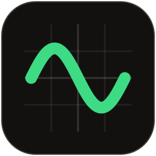
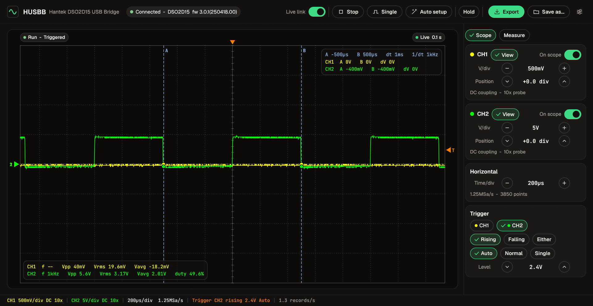
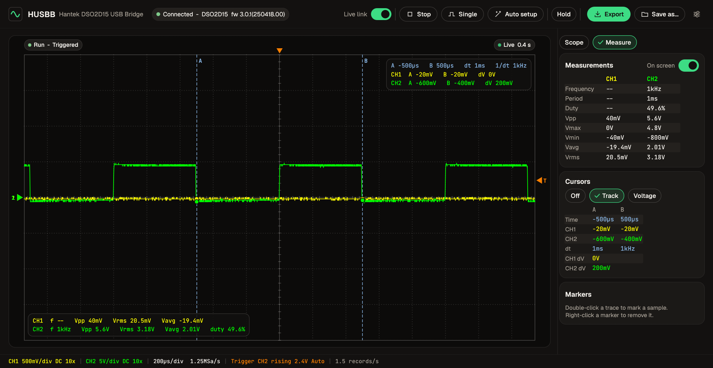

<p align="center">
  
</p>

<h1 align="center">HUSBB</h1>
<p align="center"><b>Hantek DSO2D15 USB Bridge</b> - DSO2D15 の画面を PC に、2 チャンネル同時にリアルタイム表示。</p>

<p align="center">
  <a href="README.md">English</a> |
  <a href="README.tr.md">Türkçe</a> |
  <a href="README.zh-CN.md">简体中文</a> |
  <b>日本語</b> |
  <a href="README.de.md">Deutsch</a> |
  <a href="README.es.md">Español</a> |
  <a href="README.ru.md">Русский</a>
</p>

<p align="center"><a href="https://github.com/bugragungoz/HUSBB/releases/latest"><b>HUSBB.exe をダウンロード</b></a></p>



HUSBB は **Hantek DSO2D15** オシロスコープ用のネイティブ Windows アプリです（Rust、wgpu 上の egui）。USB 経由で同じアクイジションから 2 チャンネルを読み取り、オシロスコープと同じように描画します。測定、実サンプルを読むカーソル、マーカー、画面のホールド、ワンクリックエクスポート、オシロスコープの操作にも対応し、Hantek の PC ソフトウェアは不要です。DSO2D15 専用に作られ、DSO2D15 でのみテストしています。

## なぜ作ったか

ファームウェア **3.0.1（2025-04-18）** では、Hantek 純正の DSO2D15 用 PC ソフトウェアに何も表示されません。このソフトは `PRIVate:WAVeform:DATA:ALL?` を送りますが、このファームウェアはもうそれに応答しないためです。ドキュメントにある `:WAVeform:DATA:ALL?` は応答しますが、2 チャンネルとも ON のときは片方のチャンネルを 2 回送ってきます。

DSO2D15 のファームウェアをリバースエンジニアリングした結果、`:WAVeform:DATA:DISP?` が見つかりました。ON になっている全チャンネルを、同じアクイジションのそれぞれのバッファから返します。まさにオシロスコープが今描画しているレコードです。HUSBB はこれを使うので、チャンネルの切り替えは不要で、サンプルの欠落もなく（チャンネルごとに画面上の 3850 点すべて）、CH1 と CH2 の時間関係も正確です。PC 接続中にフロントパネルがロックされる理由と、ロックを解除する方法もファームウェアから分かりました。詳細は [docs/PROTOCOL.md](docs/PROTOCOL.md)（英語）を参照してください。

## 機能

- **2 チャンネル同時・リアルタイム表示**。オシロスコープと同じ色（CH1 黄、CH2 緑）で、毎秒約 1.5 レコード - これは DSO2D15 自身の USB 上の上限です。
- **Live link スイッチ。** OFF にすると HUSBB は何も送らず、約 5 秒後に DSO2D15 がフロントパネルのロックを解除するので、本体のキーを操作できます。ON にすると HUSBB が再び制御します。
- **操作：** 実行 / 停止、シングル、オートセットアップ、チャンネル ON/OFF、V/div、ポジション、time/div、トリガーソース、スロープ、モード、レベル。変更はすべてオシロスコープから読み戻して確認します。
- チャンネルごとの **View**：HUSBB 上だけで波形を表示/非表示。
- チャンネルごとの **測定**：周波数、周期、デューティ比、Vpp、Vmax、Vmin、Vavg、Vrms。画面上に重ねて表示することもできます。
- 実サンプルにスナップし、A と B の位置で両チャンネルを読む **トラックカーソル**（dt、1/dt、dV）と電圧カーソル。
- **マーカー：** 波形をダブルクリックするとサンプルをマーク（時間と電圧）、右クリックで削除。
- **Hold** はオシロスコープを動かしたまま画面だけを止めます。
- 設定で選んだフォルダーへのワンクリック **Export**（画面の PNG とデータの CSV）、または任意の場所への **Save as...**。
- マウスホバーで時間と電圧を表示、自動再接続、設定を記憶。



## ダウンロード

Releases から [**HUSBB.exe**](https://github.com/bugragungoz/HUSBB/releases/latest) をダウンロードしてください。ファイル 1 つで、インストールは不要です。ほかに必要なのは VISA だけです（下記参照）。exe はコード署名されていないため、Windows SmartScreen が一度だけ確認を求めることがあります：*詳細情報* -> *実行*。

## 動作環境

- Windows 10 または 11（64 ビット）と Hantek DSO2D15（ファームウェア 3.0.1(250418.00) でテスト済み）。
- USBTMC に対応した VISA。オシロスコープがデバイスマネージャーの *USB Test and Measurement Devices* に表示される必要があります：Keysight IO Libraries または R&S VISA（R&S VISA 7.2 と IVI `ausbtmc` ドライバーでテスト済み）。HUSBB は実行時に `visa64.dll` を読み込みます。
- オシロスコープ **背面** の USB-B ポート。

### DSO2D15 の接続が切れる場合

すべてのポートが USB 3.x のノート PC では、DSO2D15 が 30 秒から 5 分ほどでバスから外れました。通信がまったくないときも、バッテリー駆動のときも同様です（Windows には Kernel-PnP イベント 1010 *"surprise removed as it is reported as missing on the bus"* が記録されます）。**ノート PC とオシロスコープの間に普通の USB 2.0 ハブを入れると解決しました。** `tools/idle_watch.ps1` でこのテストを再現できます。

## ビルドと実行

[Rust](https://rustup.rs)（stable、MSVC ツールチェーン）が必要です：

```bash
cargo build --release
```

```bash
target\release\HUSBB.exe
```

コマンドラインオプション（主に自動化用）：

```
--resource <VISA 名>       最初に見つかったものではなく、このオシロスコープを使う
--screenshot <file.png>    --after 秒後（既定 8 秒）にウィンドウを保存して終了
--cursors track|voltage    カーソルを表示した状態で起動
--tab measure              Measure タブで起動
```

ハードウェアの確認（DSO2D15 接続時）：

```bash
cargo run --example probe
```

```bash
cargo run --example link
```

ユニットテストは実機の DSO2D15 から記録したパケット（`tests/data`）で実行されます：

```bash
cargo test
```

## 構成

| | |
|---|---|
| `src/visa.rs` | 実行時に読み込む VISA バインディング |
| `src/protocol.rs` | `:WAVeform:DATA:DISP?` ストリームのパーサー |
| `src/scope.rs` | DSO2D15 のコマンドと設定 |
| `src/acquire.rs` | アクイジションスレッド、live link、再接続 |
| `src/measure.rs` | 測定、SI 単位の表示 |
| `src/ui/` | ウィンドウ、波形画面、カーソル、マーカー、操作部（"Bugra" デザインシステム） |
| `docs/PROTOCOL.md` | ファームウェア解析の結果 |

## 作り方

HUSBB は **Claude Opus 5.5** で作られました。DSO2D15 のプロトコルは、オシロスコープ純正のファームウェアアップデートと Hantek の PC ソフトウェアをリバースエンジニアリングして解明しました。解析はファイルの静的解析のみで、オシロスコープには何も書き込み・書き換えをしていません。

## クレジット

先行するプロトコル調査：[phmarek/hantek-dso2000](https://github.com/phmarek/hantek-dso2000) と [EEVblog の DSO2000 スレッド](https://www.eevblog.com/forum/testgear/hantek-dso2x1x-models-master-thread/)。フォント：[Geist](https://github.com/vercel/geist-font) と [JetBrains Mono](https://github.com/JetBrains/JetBrainsMono)（いずれも SIL Open Font License 1.1、`assets/fonts/OFL-*.txt`）。Hantek とは無関係です。このリポジトリには Hantek のソフトウェアやファームウェアは含まれていません。

## ライセンス

[MIT](LICENSE)
